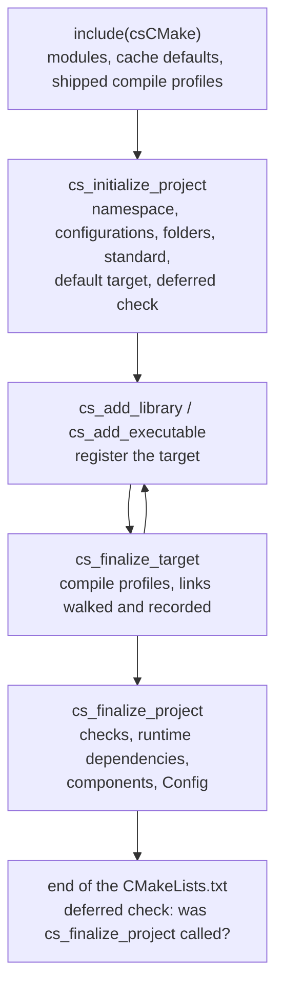

# Lifecycle of a project

What csCMake does, and when, from `include(csCMake)` to the end of the configure. The user guide says what to call;
this page says what happens.

## `include(csCMake)`

- Fails on a CMake older than 3.31.
- Runs between `cmake_policy(PUSH)` / `cmake_policy(VERSION 3.31)` / `cmake_policy(POP)`: every csCMake function and
  macro records the 3.31 policies where it is defined, whatever the including project declares.
- Includes the modules of `modules/` (each once: `include_guard(GLOBAL)`), which define the cache defaults (postfixes and
  MSVC runtime of the CMake configurations, [build configurations](../user/build-configurations.md)) and register
  the compile profiles shipped with csCMake.
- Records the csCMake folder (`CSCMAKE_ROOT_DIR`): a second csCMake folder in the same build fails.

Nothing is project-specific yet: a build tree can include csCMake once and hold several csCMake projects.

## `cs_initialize_project`

A macro, so that what it sets belongs to the scope of the project folder (and is inherited by its sub-folders). In
order:

1. the debug option `<project>_CSCMAKE_DEBUG` and `_cscmake_debug_option`;
2. checks that `project()` has a `VERSION`;
3. `CSCMAKE_SOURCE_DIR`: the project folder, base of the include paths and of the installed headers;
4. normalizes the search paths and the install prefix;
5. the output folders `<build>/bin` and `<build>/lib` (`/<CONFIG>` with multi-config generators), unless set;
6. collects the CMake variables with a `<CONFIG>` part, once per build tree (`cmake --help-variable-list`): a custom
   configuration copies them from its base;
7. parses the arguments: namespace (`CSCMAKE_NAMESPACE`), C++ standard, default compile profiles, and
   the configurations, added to the build, or, in a nested project, checked against the build;
8. sets in the project scope the variables computed by the functions called so far (see
   [project scope](#project-scope)): imported configuration mapping, postfixes, MSVC runtime, output folders of the
   custom configurations;
9. `CMAKE_CXX_STANDARD`; `CMAKE_CXX_STANDARD_REQUIRED` `ON` and `CMAKE_CXX_EXTENSIONS` `OFF` unless the project set them;
10. the configurations of the build: `CMAKE_CONFIGURATION_TYPES` with a multi-config generator; with a single-config
    one, fails if `CMAKE_BUILD_TYPE` is not one of them;
11. adds `CSCMAKE_PREFIX_PATH_HEAD` / `_TAIL` and the module path ones around `CMAKE_PREFIX_PATH` /
    `CMAKE_MODULE_PATH`;
12. `enable_testing()`; with Ninja, `CMAKE_EXPORT_COMPILE_COMMANDS` `ON` unless set (`-D...=OFF`, or the environment
    variable of the same name);
13. creates the default target `<namespace>::cscmake_base_include` (and its include folders, created on disk);
14. defers a call to the end of the current `CMakeLists.txt` that fails if `cs_finalize_project` was not called
    (`cmake_language(DEFER)`).

### What reaches beyond the csCMake targets

csCMake changes only what its own targets need, or what the project asks for (see
[Contributing to csCMake](../contributing/code.md#cmake-conventions)). The settings that reach further, and why:

| Setting | Reaches | Why |
|---|---|---|
| output folders `<build>/bin`, `<build>/lib` | every target of the project folder, third-party projects added with `add_subdirectory` included | on Windows, the DLLs are found next to the executables; kept when the project set them |
| `CMAKE_CXX_STANDARD`, `_REQUIRED`, `CMAKE_CXX_EXTENSIONS` | every target of the project folder | `CXX_STANDARD` of the project; `_REQUIRED` and `_EXTENSIONS` kept when the project set them |
| `CMAKE_MSVC_RUNTIME_LIBRARY` | the targets of the folder not created by `cs_add_*` | every target of a build must use the same MSVC runtime to link; set with `CSCMAKE_MSVC_RUNTIME_LIBRARY_<CONFIG>` |
| `CMAKE_MAP_IMPORTED_CONFIG_<CONFIG>` | every imported target of the folder | the configurations of imported targets to use (`MAPPED_TO`, `BASED_ON`): needed for the custom configurations |
| `CMAKE_CONFIGURATION_TYPES` | the build | the configurations of the first csCMake project (multi-config generators) |
| `CMAKE_EXPORT_COMPILE_COMMANDS` | the build folder | `compile_commands.json` for the editors (Ninja); kept when set |
| `enable_testing()` | the project folder | the tests of the project run with ctest |

The installed `<namespace>Config.cmake` defines, in the consumer, only names prefixed by the namespace, and unsets its
temporaries; its debug switch `<namespace>_DEBUG` is read as a plain variable (no cache entry).

### Project scope

Functions have their own scope: a variable they set is lost when they return. The functions called by
`cs_initialize_project` record the variables meant for the project with `_cs_set_in_project_scope(<name> <value>)`
(global properties); `cs_initialize_project`, a macro running in the project scope, sets them all with
`_cs_apply_project_scope_variables()`. This keeps the logic in functions (local variables, early `return()`) while
the results land where `project()` variables do.

## Targets

`cs_add_library` / `cs_add_executable` call `add_library` / `add_executable`, then register the target (aliases
excepted): `CSCMAKE_<namespace>_PROJECT_TARGETS`, the namespace on the target
(`CSCMAKE_NAMESPACE`), `<CONFIG>_POSTFIX` for each configuration and `MSVC_RUNTIME_LIBRARY`. Creating a
target before `cs_initialize_project` fails (the postfixes do not exist yet).

## `cs_finalize_target`

1. Applies the compile profiles of the target (once: a second call does not apply them again).
2. Walks the links of the target, transitively (see [Runtime dependencies](runtime-dependencies.md)), recording the
   project targets and the names that are not targets yet, and the shared libraries of imported targets.
3. Records the links of the target (`_CSCMAKE_FINALIZED_LINKS`).

Links must be complete at this point: the profiles are applied and the links walked once.

## `cs_finalize_project`

1. Marks the namespace finalized (`_CSCMAKE_PROJECT_FINALIZED_<namespace>`), for the deferred check.
2. Prints the targets, components and state (debug messages).
3. Checks every target of the project: finalized, and with the links recorded then (a link added later fails).
4. Resolves the runtime dependencies of every target, and from them the Visual Studio debugger environment.
5. Installs the components: the export of each one, the dependencies between them (cycles fail, then sorted), the
   generated `<namespace>Config.cmake` and `<namespace>ConfigVersion.cmake` (see
   [Installed packages internals](packages.md)).

## The deferred check

At the end of the `CMakeLists.txt` of `cs_initialize_project`, the call deferred at step 14 runs: if
`cs_finalize_project` was not called for the namespace, the configure fails, naming the file to fix.
