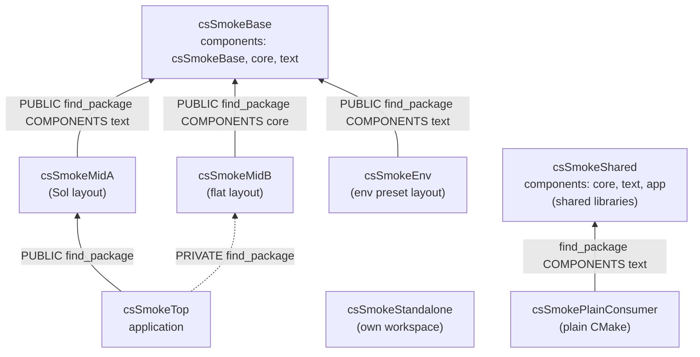
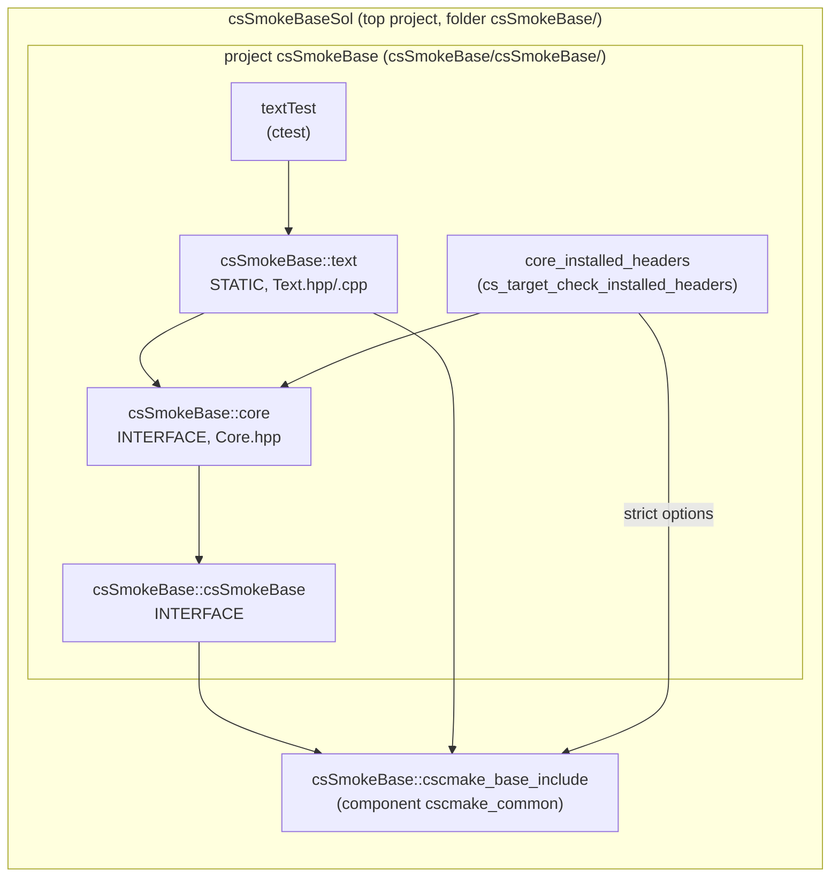
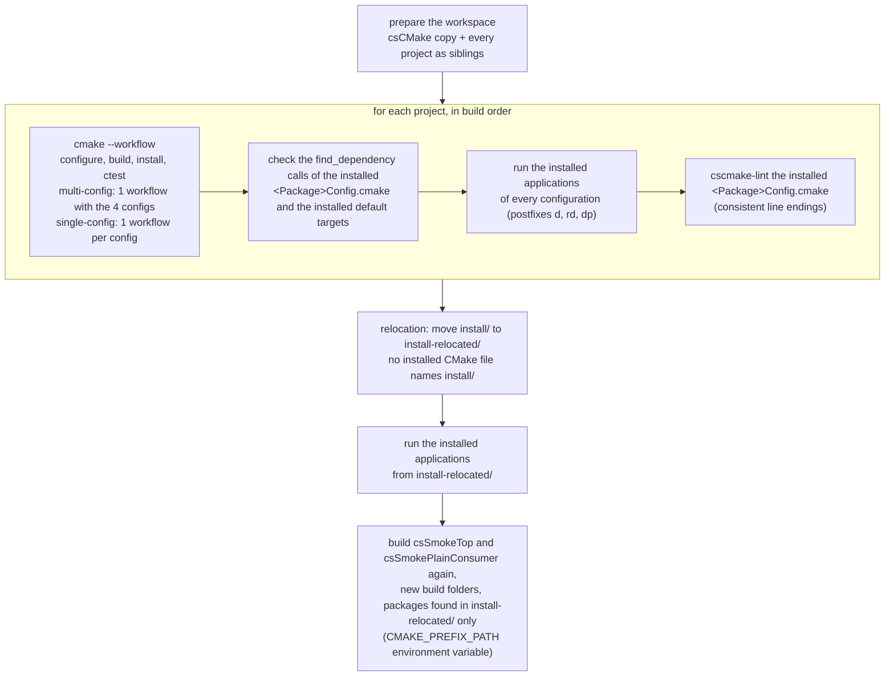

# Smoke tests

Small CMake projects in `tests/smoke/` that use csCMake exactly like real projects do (through the csv1 presets, with
csCMake as a sibling folder), built on **every preset variant** of the registry by the `smoke` GitHub workflow. The
[tutorials](../tutorials/index.md) walk through them. They prove
that the presets configure, build, install and test, that the installed packages can be found again with
`find_package`, and that the `<Package>Config.cmake` files generated by csCMake are correct.

## The projects

A chain of packages, built in this order (each project finds the previous ones in the
install folder):

| Project | Role | What it covers |
|---|---|---|
| `csSmokeBase` | base package | `<Package>Sol` top project with the package in a subproject named like the package (namespace ≠ top project name); components in their own `project()`; header-only (INTERFACE) component; static component depending on another component of the same package; ctest unit test; `cs_target_check_installed_headers` with `cscmake_strict_warnings`; compile profile `csSmokeBase_checks` (default of the project): every standard library check in Debug and Paranoid (`cscmake_hardening_debug`), the cheap ones in Release and RelWithDebInfo (`cscmake_hardening_fast`), UBSan in Paranoid, clang-tidy (`.clang-tidy`) in Paranoid with Clang on Linux |
| `csSmokeMidA` | package depending on the base | `Sol` layout; depends on `csSmokeBase` (`COMPONENTS text`) with `cs_find_package(... PUBLIC ...)`: propagated as `find_dependency` in its installed Config; default target `csSmokeMidA::cscmake_base_include` linked |
| `csSmokeMidB` | package depending on the base, simplest layout | **flat** layout: a single `project()` named like the package, library folder without its own `project()`; depends on `csSmokeBase` (`COMPONENTS core`, PUBLIC); preset layout `sibling-short` (Base, MidA, Top: `sibling`) |
| `csSmokeTop` | application using several packages | finds `csSmokeMidA` PUBLIC and `csSmokeMidB` **PRIVATE** (not propagated to its Config); `csSmokeBase` is reached through two `find_dependency` paths with different components (diamond); installed application |
| `csSmokeEnv` | application located by the environment | preset layout `env`: workspace and csCMake from `CSCMAKE_WORKSPACE_ROOT` / `CSCMAKE_ROOT` (set by `run_smoke.py`), also in the includes of its presets (`$penv{CSCMAKE_ROOT}/presets/...`); finds `csSmokeBase` there |
| `csSmokeStandalone` | self-contained application | preset layout `standalone-short`: its own workspace `csSmokeStandalone/workspace/` with a copy of csCMake, build and install folders |
| `csSmokeShared` | shared libraries | two SHARED libraries (`sharedText` uses `sharedCore`, components `text` and `core`) and an application; Windows: `CMAKE_WINDOWS_EXPORT_ALL_SYMBOLS`; the **installed** application runs from the install folder (install RPATH of `cs_add_library` / `cs_add_executable` on Linux and macOS, DLLs in `bin/` on Windows); Visual Studio: the debugger `PATH` of the application in its `.vcxproj` (its `CSCMAKE_RUNTIME_DIRS` folder, then the DLL folder, every configuration) |
| `csSmokePlainConsumer` | consumer without csCMake | plain CMake (no `include(csCMake)`): `find_package(csSmokeShared COMPONENTS text)` and `csSmokeShared::sharedText`; on Windows copies `$<TARGET_RUNTIME_DLLS>` next to its executable; its ctest runs it from the build folder; Debug and Release only (the configurations plain CMake knows) |

All csCMake projects use the four build configurations of the csv1 presets: Debug, Release, RelWithDebInfo (mapped to
`RelWithDebInfo,Release`) and the custom Paranoid (based on `Debug,Release`), with postfixes `d`, none, `rd`, `dp`.

### Package dependencies



### Inside `csSmokeBase`

The top project `csSmokeBaseSol` calls `cs_initialize_project(NAMESPACE csSmokeBase ...)`; every folder below it is
its own `project()`. Each library is installed in its own component (export) of the
`csSmokeBase` namespace.



### Layouts: `Sol` and flat

```
csSmokeMidA/                        Sol layout
  CMakeLists.txt                    project(csSmokeMidASol), cs_initialize_project(NAMESPACE csSmokeMidA ...)
  csSmokeMidA/CMakeLists.txt        project(csSmokeMidA): the library
csSmokeMidB/                        flat layout
  CMakeLists.txt                    project(csSmokeMidB), cs_initialize_project(NAMESPACE csSmokeMidB ...)
  csSmokeMidB/CMakeLists.txt        the library, no project()
```

In both, headers are included relative to the top project folder, in the build tree and once installed:
`#include <csSmokeBase/core/Core.hpp>`, `#include <csSmokeMidA/csSmokeMidA.hpp>`.

### Expected results

| Check | Expected |
|---|---|
| `csSmokeTop` (installed, every configuration, and ctest) | prints `mid-a(text(base-core)) mid-b(base-core)` |
| `csSmokeEnvApp` (installed, every configuration, and ctest) | prints `env(text(base-core))` |
| `csSmokeStandaloneApp` (installed in its own workspace, every configuration, and ctest) | prints `standalone` |
| unit tests `textTest`, `csSmokeMidATest`, `csSmokeMidBTest` | exit code 0 |
| default target in the installed `cscmake_commonTargets.cmake` | exactly `<Package>::cscmake_base_include` |
| `find_dependency` in the installed Configs | `csSmokeBase`: none; `csSmokeMidA`, `csSmokeMidB`, `csSmokeEnv`: `csSmokeBase`; `csSmokeTop`: `csSmokeMidA` only; `csSmokeStandalone`: none |

## What a smoke run does

`run_smoke.py --variant <id>` (standard library + the `cscmake` package only):



The relocation checks that the installed packages can be moved (e.g. built on a CI machine and unpacked elsewhere):
the Config files reach their files through paths relative to themselves, the installed executables find the shared
libraries of their package through a relative install RPATH (`$ORIGIN`, `@loader_path`) or next to them (Windows),
and a consumer finds the packages, and the ones they depend on (`find_dependency`), in the new folder.

```
<workspace>/
  csCMake/                          csCMake.cmake, modules/, presets/, templates/ (copied from the checkout)
  csSmokeBase/ ... csSmokeEnv/      the projects (copied from tests/smoke/)
  csSmokeStandalone/workspace/      its own workspace: csCMake (copied), build/, install/
  build/<variant>/<project>         created by the presets (short folder names with the *-short preset layouts)
  install/<variant>/<project>
  install-relocated/                install/ moved by the relocation step (install/ then holds the rebuilt consumers)
```

The install prefix of each project is `install/<variant>/<project folder>` and `CMAKE_PREFIX_PATH` contains
`install/<variant>`: `find_package(<Package>)` finds `<prefix>/<Package>*/lib/cmake/<Package>`, so **the
project folder must be named like the package**.

## Where it runs

- **GitHub**: `.github/workflows/smoke.yml`. A first job turns the preset registry into the job matrix
  (`ci_matrix.py`: variant → runner, e.g. `ubuntu-24.04-arm`, `windows-2025-vs2026`, `macos-26`), then one job per
  variant runs `run_smoke.py` (42 variants × 4 configurations: Linux, Windows with Visual Studio and Ninja
  generators, macOS arm64). Windows Ninja jobs run in a Visual Studio developer environment (`setup-msvc-dev`).
- **Locally**:

  ```bash
  python tests/smoke/run_smoke.py --variant csv1-linux-ubuntu24.04-x64-generic-gcc-default-ninjamulticonfig
  python tests/smoke/run_smoke.py --variant <id> --workspace /tmp/ws --no-lint
  python -m pytest --run-all     # test_run_smoke.py: every variant of this machine (CSCMAKE_SMOKE_VARIANTS=id1,id2)
  ```

## Adding a project

1. Add the folder under `tests/smoke/` (folder name = package name), with `CMakeLists.txt`, `CMakePresets.json`
   and `csCMakeProjectSetup.json` (copy them from an existing project).
2. Add it to `PROJECTS` in `run_smoke.py`, after the projects it depends on, with the packages its Config must
   `find_dependency` and its installed applications with their expected output (`test_every_smoke_project_is_run`
   fails until you do).
3. Format and lint its CMake files (`gersemi -i`, `cscmake-lint`), describe it on this page (and in a tutorial when
   it shows something new).

Not covered: `cs_target_use_openmp` (it needs OpenMP on every runner); the runtime dependency analysis and the
cyclic components are covered by configure tests (`tests/cmake/`).
