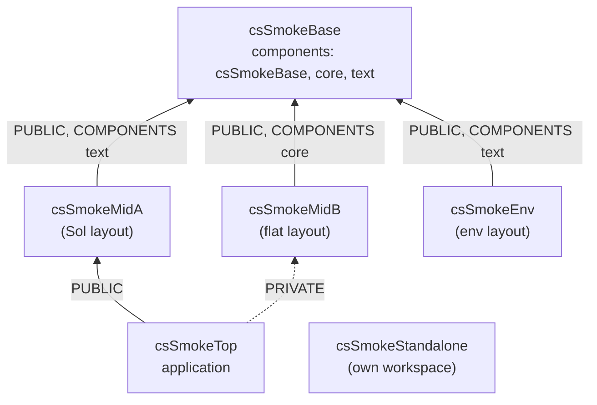

# Tutorials

The tutorials walk through real csCMake projects: the *smoke projects* of `tests/smoke/`. CI builds, installs and tests
them on every supported platform, compiler and generator, so the code shown here is code that works. Each file is
included from the repository as it is.

They form a chain of packages, each one finding the previous ones in the install folder of the workspace:



1. [A package with components](package-with-components.md): `csSmokeBase`.
2. [Using a package](using-a-package.md): `csSmokeMidB` (flat layout) and `csSmokeMidA` (`Sol` layout).
3. [An application](application.md): `csSmokeTop`.
4. [Other layouts](other-layouts.md): `csSmokeEnv` (workspace from the environment) and `csSmokeStandalone` (its own
   workspace).

## Building them yourself

`tests/smoke/run_smoke.py` builds the whole chain in a temporary workspace (a copy of csCMake and of every project,
side by side), for one preset variant:

```bash
python tests/smoke/run_smoke.py --variant csv1-linux-ubuntu24.04-x64-generic-gcc-default-ninjamulticonfig
```

or copy one project next to a clone of csCMake and run its workflow preset, after the projects it depends on. See
[Smoke tests](../advanced/smoke-tests.md) for what a smoke run checks.

```{toctree}
:hidden:

package-with-components
using-a-package
application
other-layouts
```
