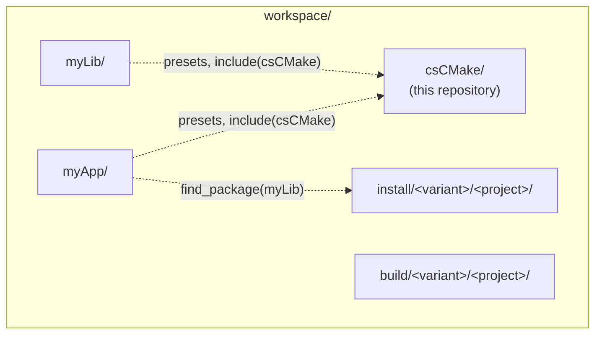

# Getting started

This page sets up a first csCMake project: where csCMake lives, the three files a project needs, and the commands
that configure, build, test and install it.

## Requirements

- **CMake 3.31** or newer (checked when csCMake is included; the csv1 presets use preset schema 10).
- A C++ toolchain:
  - Linux: GCC or Clang;
  - Windows: MSVC or MSVC + LLVM (clang-cl), with the Visual Studio generators, or Ninja / Ninja Multi-Config from a
    Visual Studio developer environment (Developer PowerShell, `vcvars`, or an IDE using its toolset);
  - macOS (Apple Silicon): Apple Clang, with Ninja, Ninja Multi-Config or Xcode.
- Python is not needed to use csCMake: the presets are committed, ready to use.

## Where csCMake lives

csCMake is not installed: a project uses a copy of it, and finds it through its presets. The usual layout is a
*workspace* folder holding csCMake, the projects, and the build and install folders of every project:



```text
workspace/
  csCMake/                     csCMake: a release package, or a git clone
  myLib/                       a project
  myApp/                       another project, using myLib
  build/<variant>/<project>/   created by the presets
  install/<variant>/<project>/ created by the presets: other projects find the installed packages here
```

This is the `sibling` *layout*. A project chooses its layout in one file (below); the others are `standalone` (a
workspace inside the project, e.g. for a self-contained application) and `env` (the workspace and csCMake given by
environment variables). See [Presets](presets.md#layouts).

Get csCMake in the workspace in one of two ways:

- **a release** (a fixed version): download `csCMake-<version>.tar.gz` (or `.zip`) from the GitHub Releases of csCMake
  and unpack it in the workspace; it creates `csCMake/`. `SHA256SUMS` lists the checksums of the archives
  (`sha256sum -c SHA256SUMS --ignore-missing`). The documentation of that version is `csCMake-docs-<version>.zip`;
- **a git clone**: `git clone <csCMake repository> csCMake`, on a release tag (`git checkout v<version>`) or on a
  branch (`main`: the latest release, `dev`: the development).

## The files of a project

A minimal project, `myApp/`, with one library and one executable (the files below are the ones of
`tests/smoke/myApp`, built on every platform by the csCMake CI):

```text
myApp/
  CMakeLists.txt
  CMakePresets.json
  csCMakeProjectSetup.json
  myApp/
    CMakeLists.txt
    core/Greeting.hpp
    core/Greeting.cpp
    main.cpp
```

### `CMakePresets.json`

It includes every preset of csCMake: one per supported platform, compiler and generator.

```{literalinclude} ../../tests/smoke/myApp/CMakePresets.json
:language: json
```

### `csCMakeProjectSetup.json`

It chooses the layout: here the workspace is the parent folder of the project, csCMake one of its folders. The csCMake
presets include it by this name, from the folder of `CMakePresets.json`. It can also add values of the project, for
every variant or per operating system, or choose other folders: see
[Choosing the project setup](presets.md#choosing-the-project-setup).

```{literalinclude} ../../tests/smoke/myApp/csCMakeProjectSetup.json
:language: json
```

### `CMakeLists.txt`

```{literalinclude} ../../tests/smoke/myApp/CMakeLists.txt
:language: cmake
```

`cs_initialize_project` sets up the project: the namespace of its installed targets and package
(`myApp::core`, `find_package(myApp)`), the C++ standard, the build configurations. It must follow `project()` with a
`VERSION`: it is the version of the installed package. At the end of this file, csCMake finalizes the project:
it applies the compile profiles of the targets, resolves their runtime dependencies and generates the installed
package.

### `myApp/CMakeLists.txt`

```{literalinclude} ../../tests/smoke/myApp/myApp/CMakeLists.txt
:language: cmake
```

- `cs_add_library` / `cs_add_executable` work like `add_library` / `add_executable`, and register the target in the
  project.
- `PRIVATE_INSTALL` adds a source that is also installed with the target (a public header).
- `myApp::cscmake_base_include` is the default target of the project: linking it makes the headers includable relative
  to the project folder, `#include <myApp/core/Greeting.hpp>`, in the build tree and once installed.
- `cs_install_target` installs the target in a *component* of the package (`core`, `app`); `DEFAULT`
  makes the component part of `find_package(myApp)` without `COMPONENTS`.
- `add_test` is CMake's own: `cs_initialize_project` enables the tests, the test presets run them.

The sources: `core/Greeting.hpp` declares `myapp::greeting()`, `core/Greeting.cpp` returns `"Hello from myApp"`,
`main.cpp` prints it:

```{literalinclude} ../../tests/smoke/myApp/myApp/main.cpp
:language: cpp
```

[Targets and sources](targets.md) explains each command.

## Configure, build, test, install

List the presets available on this machine:

```bash
cmake --list-presets
```

Each preset name describes the platform, the compiler and the generator, e.g.
`csv1-linux-ubuntu24.04-x64-generic-gcc-default-ninjamulticonfig`. The simplest way to do everything is the workflow
preset of the same name, with `workflow-` in front and the configurations at the end: it configures, then builds,
installs and tests each configuration.

```bash
cmake --workflow --preset workflow-csv1-linux-ubuntu24.04-x64-generic-gcc-default-ninjamulticonfig-debug-release
```

or step by step:

```bash
cmake --preset csv1-linux-ubuntu24.04-x64-generic-gcc-default-ninjamulticonfig
cmake --build --preset build-csv1-linux-ubuntu24.04-x64-generic-gcc-default-ninjamulticonfig-debug
cmake --build --preset install-csv1-linux-ubuntu24.04-x64-generic-gcc-default-ninjamulticonfig-debug
ctest --preset test-csv1-linux-ubuntu24.04-x64-generic-gcc-default-ninjamulticonfig-debug
```

(installing is a build of the `install` target: `install-*` are build presets).

The build goes to `workspace/build/<variant>/myApp/`, the installation to `workspace/install/<variant>/myApp/`, where
another project of the workspace finds it with `find_package(myApp)`. [Presets](presets.md) explains the names and
the folders.

## Ship the application

`myApp/CMakeLists.txt` also declares a *deployment*:

```cmake
cs_deployment(app TARGETS myApp)
```

The install above also made `workspace/build/<variant>/myApp/deploy/app-Release/` (with a single-config generator:
in the build folder of the configuration, `myApp/release/deploy/`), a folder that runs on another machine without the
workspace:

```text
deploy/app-Release/
  bin/myApp                      the application (and every target of TARGETS)
  lib/                           the shared libraries it needs: the project's own, and the ones of other packages
  system-requirements.txt        what the machine needs from the system, with the apt install line
```

- **Nothing else to write.** The shared libraries of the project come from the targets. The libraries of other
  packages (e.g. OpenCV and Qt from the workspace) are found from the build and copied with their symlinks. The
  libraries of the system (`/lib`, `/usr/lib`) are not shipped: `system-requirements.txt` lists them, with their
  Debian packages, for a machine with the same system release.
- **Checked.** The install fails if the folder would not run: a library not found, or a library of the system
  loaded instead of the copy in the folder (e.g. the Qt of the system).
- **Independent of the package.** Nothing of it goes to the install folder, and it can ship targets the package does
  not install (samples) and data files: `cs_deployment(demo TARGETS sample FILES data/input.png DESTINATION share)`.
  A project can declare several deployments, each a complete folder of its own.
- **Configurations.** Made in `Release` by default (`CONFIGS` chooses others), skipped in the other configurations.
  To make it alone, without installing: `cmake --build --preset <build preset> --target cs_deploy_app`.

Run it from anywhere, with an empty environment:

```bash
env -i workspace/build/<variant>/myApp/deploy/app-Release/bin/myApp
```

Linux today. On Windows and macOS a deployment has the binaries of the project only, for now, with a warning.
[csDeployment](../reference/csDeployment.rst) is the reference.

## Next

- [Targets and sources](targets.md): libraries, executables, sources and installed headers, links, when the
  project is finalized.
- [Dependencies](dependencies.md): other packages, and other csCMake projects.
- [Installed packages](install.md): components and the generated `<namespace>Config.cmake`.
- [Build configurations](build-configurations.md), [Compile profiles](compile-profiles.md), [Presets](presets.md).
- [Troubleshooting](troubleshooting.md).
