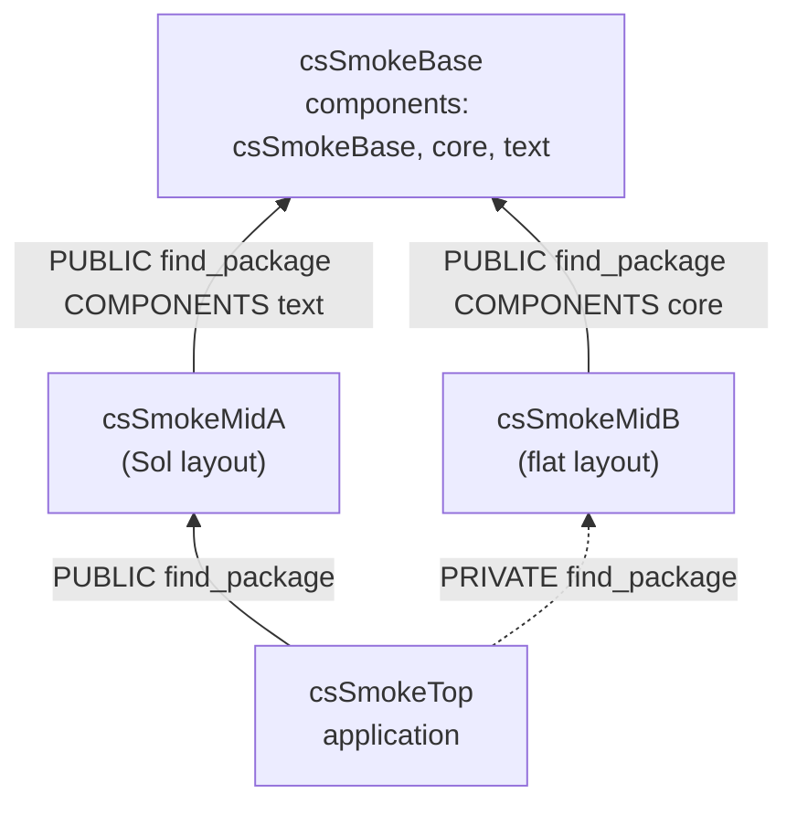
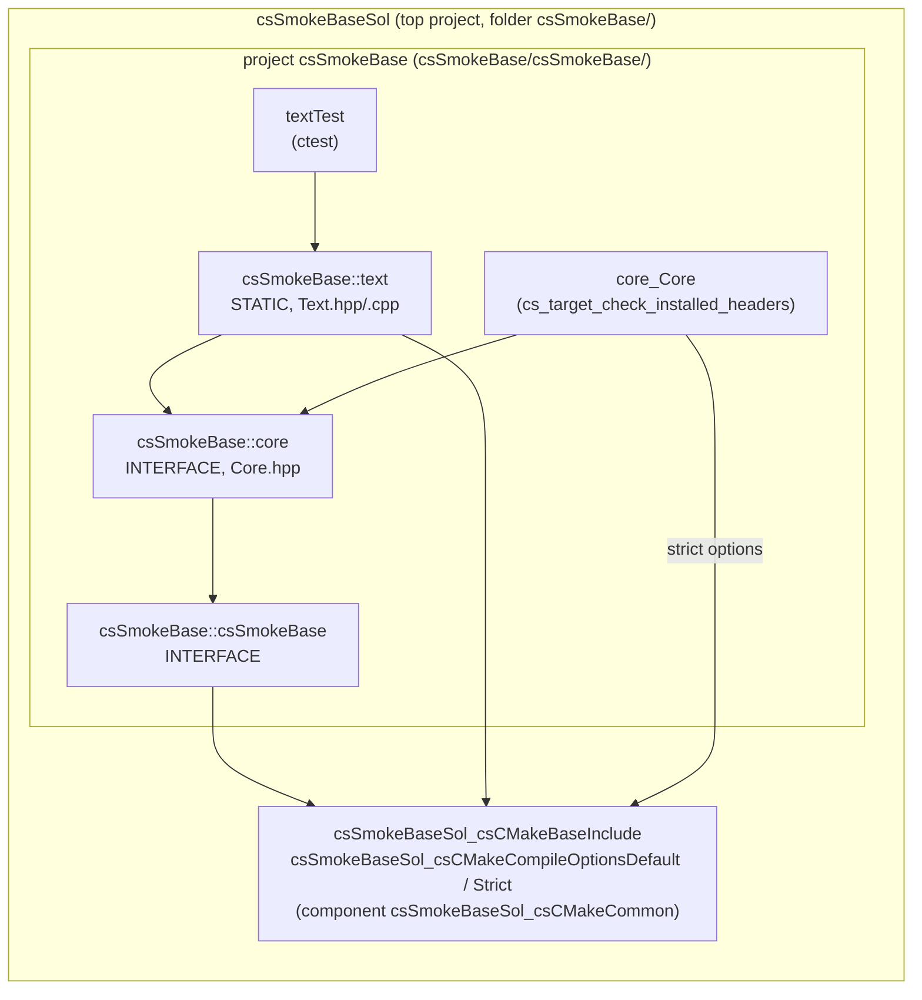
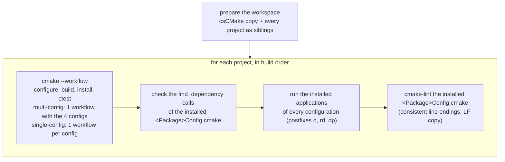

# csCMake smoke tests

Small CMake projects that use csCMake exactly like real projects do (through the csv1 presets, with csCMake as
a sibling folder), built on **every preset variant** of the registry by the `smoke` GitHub workflow. They prove
that the presets configure, build, install and test, that the installed packages can be found again with
`find_package`, and that the `<Package>Config.cmake` files generated by csCMake are correct.

## The projects

A chain of packages, built in this order (each project finds the previous ones in the
install folder):

| Project | Role | What it covers |
|---|---|---|
| `csSmokeBase` | base package | `<Package>Sol` top project with the package in a subproject named like the package (namespace ≠ top project name); components in their own `project()`; header-only (INTERFACE) component; static component depending on another component of the same package; ctest unit test; `cs_target_check_installed_headers` with the strict options |
| `csSmokeMidA` | package depending on the base | `Sol` layout; depends on `csSmokeBase` (`COMPONENTS text`) with `cs_find_package(... PUBLIC ...)`: propagated as `find_dependency` in its installed Config; default targets (`_csCMakeBaseInclude`, `_csCMakeCompileOptionsDefault`) linked |
| `csSmokeMidB` | package depending on the base, simplest layout | **flat** layout: a single `project()` named like the package, library folder without its own `project()`; depends on `csSmokeBase` (`COMPONENTS core`, PUBLIC); `csCMakeProjectSetup-shortBuildPath.json` (the others use `-default`) |
| `csSmokeTop` | application using several packages | finds `csSmokeMidA` PUBLIC and `csSmokeMidB` **PRIVATE** (not propagated to its Config); `csSmokeBase` is reached through two `find_dependency` paths with different components (diamond); installed application |

All projects use the four build configurations of the csv1 presets: Debug, Release, RelWithDebInfo (mapped to
`RelWithDebInfo,Release`) and the custom Paranoid (based on `Debug,Release`), with postfixes `d`, none, `rd`, `dp`.

### Package dependencies



### Inside `csSmokeBase`

The top project `csSmokeBaseSol` calls `cs_initialize_project` and `cs_finalize_project(csSmokeBase)`; every
folder below it is its own `project()`. Each library is installed in its own component (export) of the
`csSmokeBase` namespace.



### Layouts: `Sol` and flat

```
csSmokeMidA/                        Sol layout
  CMakeLists.txt                    project(csSmokeMidASol), cs_initialize_project, cs_finalize_project(csSmokeMidA)
  csSmokeMidA/CMakeLists.txt        project(csSmokeMidA): the library
csSmokeMidB/                        flat layout
  CMakeLists.txt                    project(csSmokeMidB), cs_initialize_project, cs_finalize_project(csSmokeMidB)
  csSmokeMidB/CMakeLists.txt        the library, no project()
```

In both, headers are included relative to the top project folder, in the build tree and once installed:
`#include <csSmokeBase/core/Core.hpp>`, `#include <csSmokeMidA/csSmokeMidA.hpp>`.

### Expected results

| Check | Expected |
|---|---|
| `csSmokeTop` (installed, every configuration, and ctest) | prints `mid-a(text(base-core)) mid-b(base-core)` |
| unit tests `textTest`, `csSmokeMidATest`, `csSmokeMidBTest` | exit code 0 |
| `find_dependency` in the installed Configs | `csSmokeBase`: none; `csSmokeMidA`, `csSmokeMidB`: `csSmokeBase`; `csSmokeTop`: `csSmokeMidA` only |

## What a smoke run does

`run_smoke.py --variant <id>` (standard library + the `cscmake` package only):



```
<workspace>/
  csCMake/                          csCMake.cmake, utils/, presets/, templates/ (copied from the checkout)
  csSmokeBase/ ... csSmokeTop/      the projects (copied from tests/smoke/)
  build/<variant>/<project>         created by the presets (short folder names with shortBuildPath)
  install/<variant>/<project>
```

The install prefix of each project is `install/<variant>/<project folder>` and `CMAKE_PREFIX_PATH` contains
`install/<variant>`: `find_package(<Package>)` finds `<prefix>/<Package>*/lib/cmake/<Package>`, so **the
project folder must be named like the package**.

## Where it runs

- **GitHub**: `.github/workflows/smoke.yml`. A first job turns the preset registry into the job matrix
  (`ci_matrix.py`: variant → runner, e.g. `ubuntu-24.04-arm`, `windows-2025-vs2026`), then one job per variant
  runs `run_smoke.py` (20 variants × 4 configurations).
- **Locally**:

  ```bash
  python tests/smoke/run_smoke.py --variant csv1-linux-ubuntu24.04-x64-generic-gcc-default-ninjamulticonfig
  python tests/smoke/run_smoke.py --variant <id> --workspace /tmp/ws --no-lint
  python -m pytest --run-all     # test_run_smoke.py: every variant of this machine (CSCMAKE_SMOKE_VARIANTS=id1,id2)
  ```

## Adding a project

1. Add the folder under `tests/smoke/` (folder name = package name), with `CMakeLists.txt`, `CMakePresets.json`
   and `csCMakeProjectSetup.json` (copy them from an existing project).
2. Add it to `PROJECTS` in `run_smoke.py`, after the projects it depends on, with the packages its Config must
   `find_dependency` and its installed applications with their expected output (`test_every_smoke_project_is_run`
   fails until you do).
3. Format and lint its CMake files (`cmake-format -i`, `cmake-lint`), describe it in this file.

Not covered yet (shared libraries and the DLL dependency analysis, cyclic components, strict configuration,
clang-tidy, OpenMP, the standalone setup, macOS, ...): see "Phase 2 — not covered by the smoke projects" in
[PLAN.md](../../PLAN.md).
